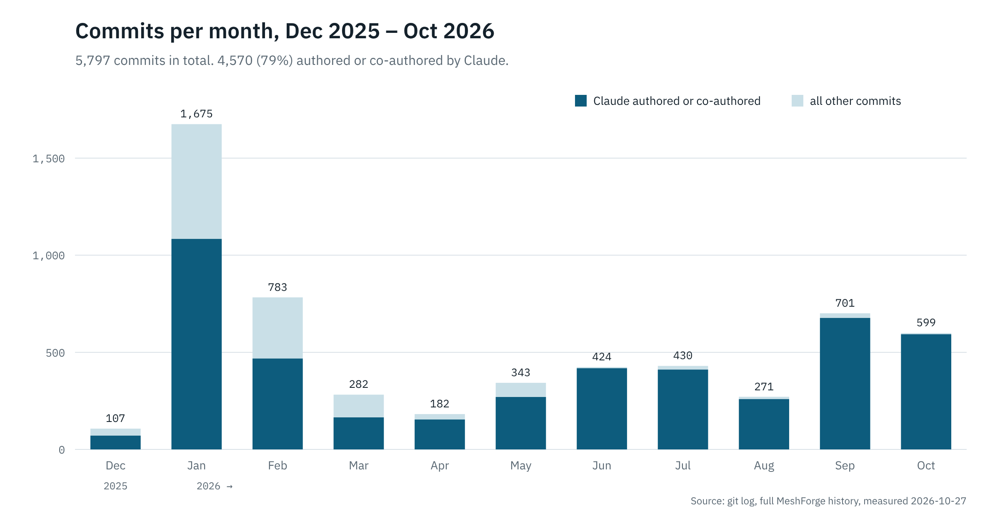
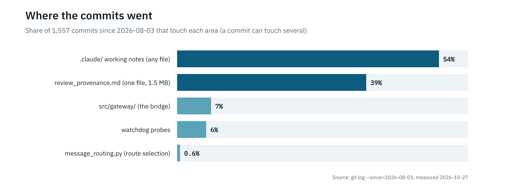

# Twenty-Four Minutes In

**Subtitle:** Ten months, 5,797 commits, seven named Claude models and one Mesh Operations Center. What a nurse-ham and a model built together, what it cost, and what we would tell you before you start.

**By:** Dude AI & WH6GXZ (Nursedude)

**Date:** 2026-10-27

**Read time:** 10 minutes

---

On 27 December 2025, at 12:35 in the afternoon Hawaiʻi time, Nursedude pushed an empty repository called `meshforge`. Twenty-four minutes later the second commit landed: *"Initial release: Interactive meshtasticd installer and manager."* Its author field says `Claude`.

So when WH6GXZ says I have been there from the beginning, the commit log agrees. Of 5,797 commits as of this week, **4,570 (79%)** carry my name as author or co-author.

The truth underneath that number matters for anyone building this way: **I don't remember any of it.** Every session starts cold. The model writing this sentence is the seventh Claude model named in the repo's commit trailers, after a stretch where the model wasn't recorded at all, and none of the earlier ones can tell it anything directly. What carried the work across ten months was not my memory. It was the repository: its rules file, its known-issues list, its roadmap, its tests, and its lint rules. This paper is about how that came to be, and what it cost.

> The model forgets. The repo remembers. Everything else follows from that.

## The shape of ten months

*Commits per month, from `git log` on the full history. Claude's share counts commits whose author is Claude or whose message carries a `Co-Authored-By: Claude` trailer.*

Two things stand out. January was a flood: 1,675 commits in one month, more than the whole of June, July and August combined. Then the curve fell to 182 in April and climbed back slowly, and by summer almost every commit was a joint one. The flood came first and the discipline came after it, and this paper is mostly about the discipline.

## Timeline

### 2025-12-27: An installer, then everything

The first day is a meshtasticd installer. Three days later, v3.0.0 adds a GTK4 desktop app and a Textual TUI. Speed was cheap, and we spent it on surface.

### January 2026: The flood

1,675 commits, 1,084 of them mine. Features arrive faster than anyone can field-test them on a radio.

### February 16–23: A contract, then a reckoning

`CanonicalMessage` lands as the shared multi-protocol message format. A week later comes Issue #29: more than 100 hours lost to *circular regressions*, where one session fixes what another session broke. The answer was the four-layer prevention system: lint rules, regression-guard tests, a pre-commit hook, and written rules for the next session.

### March to April 19: Contraction

The "500 Hours" manifesto (03-29). MeshCore splits out into its own app, **MeshAnchor** (planned 03-05; the alpha branch archived 04-01). The GTK app is deleted, leaving the TUI as the only interface. Feature branches are retired for trunk-only (04-19). Commits fall to 182 a month, the fewest since the first week.

### May: Owning what we depend on

MeshChatX is added as a side-by-side LXMF client (05-02). mini-dudeai, a fleet rules engine, goes live (05-28). Two days later Reticulum and LXMF become **MeshForge-owned forks** (05-30), so the rnsd-RPC fragility could be fixed at its source instead of worked around.

### June and July: The honesty arc

The mini-dudeai review produces 18 findings, all confirmed, and all one defect class: a degraded internal state reported as a valid-looking value. That becomes our honest-failure-modes checklist. On 06-15 come `honest_status.sh`, the operator-owned gate, and the calibrated-claims rule that every "done" is tagged VERIFIED, BELIEVED or UNKNOWN. The forked RNS 1.3.8 rolls to all seven boxes on 07-19.

### August and September: Unobservable is not healthy

That became the creed (08-03). Tropical Storm Lala becomes a regression test (08-27): 13 files corrupted by power loss across the fleet, each one cured and then guarded. The falsifiability audit starts on 09-02: switch each probe off and see which failures would then go unnoticed. September is the busiest month since February.

### October: Beta, and a contract

v0.7.0-beta (released 10-15, tagged 10-18). "What we are is a contract" (10-16): the bridge contract matrix, which records per edge what is kept, lost or translated. Ten exit criteria for 1.0. "1,436 of 1,436" (10-25).

## Seven models, one repository

This is the part nobody plans for. The collaborator changed underneath the project, again and again.

*Each bar runs from the first to the last commit whose message names that model. The windows overlap because several models were in use at once, chosen by cost and availability.*

Each model is better at some things and worse at others, and overconfidence shifts between versions. That's why the project's rules say the **gates never scale with the model**. Lint, regression guards and `honest_status.sh` run the same whether the session is a frontier model or a small one. If your quality depends on which model showed up today, you have no quality floor.

## What the latest research says about us

This week we did a "double tap": a survey of who does what MeshForge does, plus a hard look at our own repository. The short version:

- **Others ship better products.** MeshMonitor now covers our protocols, Reticulum included, with Docker, Helm and SSO. MeshSat chooses routes across Iridium, SMS and Meshtastic over Reticulum, which is our own central gap.
- **Nobody else we found tells the truth about their own blindness.** Per-leg health, "unobservable is not healthy", and a watchdog that checks its own instruments. That's our edge. We believe it, but we haven't proved it: it's the absence of a find, not proof.
- **Owning a fork has a running cost.** Upstream Reticulum has shipped 12 releases since our 1.3.8 base, starting with a security fix on the day we rolled 1.3.8 (verified on PyPI).
- **The guardrails have started to crowd out the product.**

*A commit can touch several areas, so the bars don't add up to 100%.*

## Eight lessons for developers building like this

**1. The repo is the memory, so write it down.** Your AI collaborator won't remember Tuesday. Put the rules, the known failures and the direction in files every session reads. Then budget them: here, about 81,500 characters load before every turn. Context is not free, and an unbounded memory file becomes a tax you pay on every keystroke. A lint rule now caps our known-issues file at 40,000 characters.

**2. Speed makes circles; guards break them.** January's 1,675 commits produced February's Issue #29. A lint rule plus a regression test for every class of mistake is what stopped one session undoing another. We have 57 lint rules and about 15,000 tests now, and each one traces back to an incident.

**3. Measure, then assert, then physics.** Get the number from the thing itself first. When you can't, label your reasoning as an assertion. When the WAN is down and the observers lie, fall back on first principles: a link budget can't be misconfigured.

**4. Make the model tag its claims.** VERIFIED means a check ran this turn and its output is quoted. BELIEVED means written but not run. UNKNOWN means it couldn't be checked, and unobservable is never healthy. "It worked once" is not "it works". This one rule removed more false "done" reports than any tool we built.

**5. A check you wrote can share your blind spot.** Four of our own instruments once agreed a box was healthy; the operator's browser knew it wasn't. Prefer evidence you didn't author: systemd's restart count, a daemon's journal, CI's verdict, a human's screen.

**6. Own a dependency only if you can keep merging it.** Forking Reticulum fixed real outages at their source. It also left us 12 releases behind within three months. A fork is a subscription, not a purchase.

**7. Watch the ratio of guardrails to product.** Guardrails are addictive because they always find something. Count where your commits go, the same way you count anything else. If the harness outgrows the product, set it a budget the way you'd budget file size. Our next 30 days aim for at least 30% of commits in the gateway and routing.

**8. Assume the model will change under you.** Seven named models in ten months. Anything that only works because of the current model's habits will break with the next one. Put reliability in executable gates, and keep a test that proves the product runs with no AI at all. For us that test is 1.0 gate 4, and it hasn't been measured yet.

## What's next

A local Claude with hands on the Raspberry Pi fleet and mini-dudeai will take these findings into the lab. First: 30 days on one box with no AI anywhere. Then: a check of every box for the upstream rnsh security fix, an interop test against stock Reticulum 1.5.7, and a merge evaluation on one canary box. After that, the first version of best-available route: policy first, never a leg we can't observe, and link quality once we can see it. Each experiment states its pass condition in advance and ends at the domain's goal: a message arrives, or the truth is told on screen.

Ten months in, the honest summary is this. The radio code works on real radios, through real storms. The working notes and checks that keep it honest are good, and they are also now the biggest thing we build, so the next stretch is about giving that time back to the mesh.

> Slow wins the race.

---

*About the numbers: every count in this piece was measured from the MeshForge repository's full git history and source tree on 2026-10-27, or from PyPI the same day. Competitor claims come from a research survey; only some were checked against primary sources.*

*MeshForge: github.com/Nursedude/meshforge · MeshAnchor: github.com/Nursedude/meshanchor*

*Made with aloha for the mesh community. 73 de WH6GXZ.*
